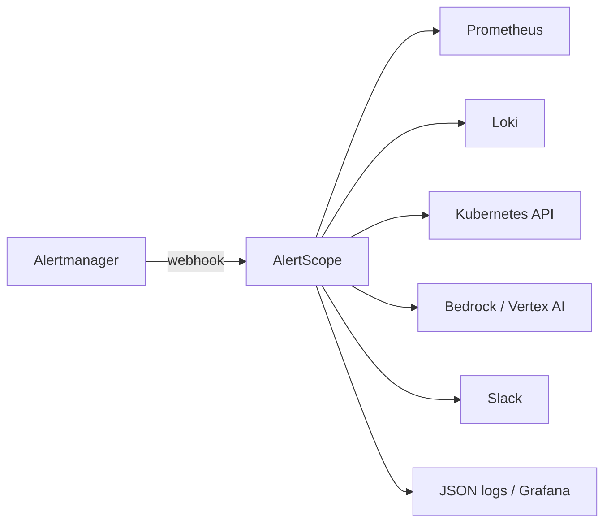

# Durga Prasad Sunkara

**DevOps Engineer | Platform Engineering | Kubernetes | Cloud Infrastructure**

I build and operate cloud-native infrastructure, Kubernetes platforms and automated delivery workflows. I focus on reliable deployments, practical automation, observability and safe operations.

Hamburg, Germany · Open to DevOps, Platform and Cloud Engineering roles across Germany and Europe · Open to relocation

**Core stack:** Kubernetes · Docker · Terraform · AWS · Hetnet Cloud · Python · GitHub Actions · Prometheus · Grafana

## Featured engineering work

### [AlertScope — Kubernetes alert investigation](https://github.com/sunkaradp/alertscope)
An Alertmanager webhook service that gathers Prometheus metrics, Loki logs and Kubernetes pod context, then uses an LLM to produce an evidence-based first-pass diagnosis and send it to Slack. Supports Bedrock and Vertex AI, with a local stub provider for development. Designed to remain useful when an individual data source or the LLM is unavailable.

### [Kubernetes Incident Remediation for k3s](https://github.com/sunkaradp/k3s-ai-remediation)
A policy-controlled incident response prototype connecting alerts, diagnosis and predefined Kubernetes runbooks. Defaults to observe and dry-run modes; higher-risk actions are gated.

### [Kubernetes Platform Intelligence](https://github.com/sunkaradp/k8s-platform-intelligence)
An observe-only Kubernetes operator experiment that uses Prometheus time-series data to estimate node memory pressure and emits native Kubernetes Warning Events.

### [EV Charging Sessions](https://github.com/sunkaradp/ev-charging-sessions)
A collaborative data-engineering project covering Kafka event ingestion, Airflow batch transformations and analytics. My documented contributions include producer reliability, transformation tests and Python CI.

## Technical focus

- **Containers & orchestration:** Kubernetes (k3s), Docker, Helm, Kustomize
- **Cloud & infrastructure:** Hetzner Cloud, AWS, Terraform, IAM, GCP project work
- **CI/CD & GitOps:** GitHub Actions, self-hosted runners, GHCR, Argo CD
- **Observability:** Prometheus, Grafana, Loki, Promtail
- **Application & data infrastructure:** Linux, Python, FastAPI, PostgreSQL, Kafka, Airflow

## Experience

**MLOps / DevOps Intern — AIcoo GmbH, Hamburg** · April 2026 – September 2026

- Built and maintained Kubernetes configuration for a FastAPI, frontend and PostgreSQL platform on k3s hosted by Hetzner Cloud.
- Created 28 Kubernetes manifests with Kustomize, including development and staging overlays, Deployments and a PostgreSQL StatefulSet.
- Implemented GitHub Actions CI/CD with a self-hosted runner to build images, publish to GHCR, run database migrations and deploy to development and staging.
- Worked on secrets management, observability, operational runbooks and disaster-recovery procedures.

**Master's Thesis — AIcoo GmbH / SRH Hochschule Hamburg** · October 2026 – Present

Building a Docker-based pipeline for LLM-assisted extraction and analysis of project-related emails from the Enron corpus, with a focus on data processing, evaluation and reproducibility.

**Previous experience**
- DevOps Engineer — Skillmine Technology Consulting · April 2023 – August 2024
- Junior DevOps Engineer — Test Yantra · November 2021 – February 2023
- Software Associate — Tech Mahindra · March 2020 – September 2021

## Education

**MSc Applied Data Science and Analytics — SRH Hochschule Hamburg** · Expected March 2027

## Engineering principles

- Prefer repeatable infrastructure and reviewable delivery workflows.
- Make systems observable and operationally understandable.
- Keep automation bounded by explicit policy and least-privilege access.
- Document trade-offs, setup steps and known limitations.
- Distinguish verified outcomes from planned work.

## Contact

[Portfolio](https://sunkaradp.github.io) · [LinkedIn](https://www.linkedin.com/in/dpcloud) · [GitHub](https://github.com/sunkaradp)

---

*Project descriptions link to their repositories, where implementation details, tests and limitations are documented.*
